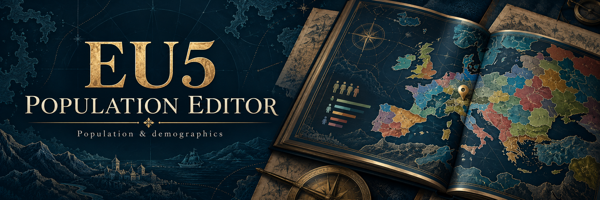
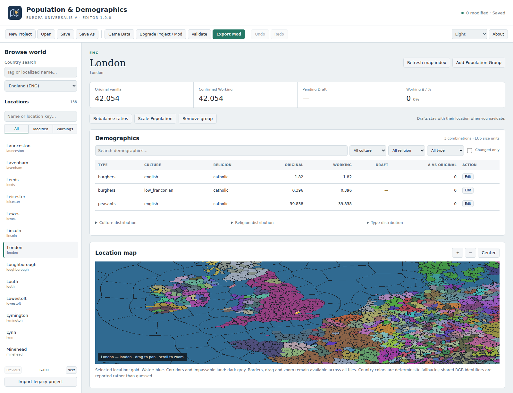
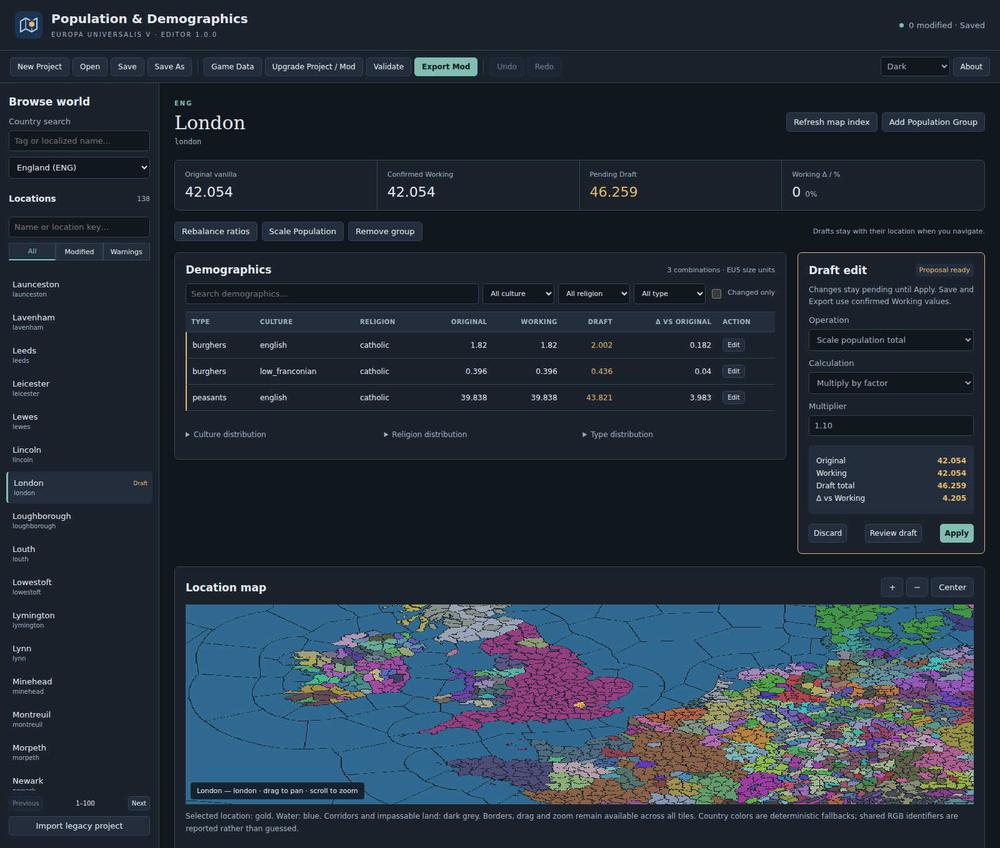

# EU5 Population Editor

Explore and edit Europa Universalis V population data with an offline desktop editor for **Windows 10/11** and **GNU/Linux**. Compare demographics, review changes, and export a separate mod while keeping the game installation untouched.

**[Downloads](https://github.com/Davoda1/EU5-Population-Editor/releases)** · **[User manual](https://davoda1.github.io/EU5-Population-Editor-Manual/)** · **[Report an issue](https://github.com/Davoda1/EU5-Population-Editor/issues)**

<picture>
  <source media="(prefers-color-scheme: dark)" srcset="docs/extras/workspace-dark.png">
  <source media="(prefers-color-scheme: light)" srcset="docs/extras/workspace-light.png">
  
</picture>

*Explore population groups and their location on the map. The editor supports system, light and dark themes.*

## A clear editing workflow

- **Find a location.** Browse countries alphabetically, search by name or tag, and navigate the map with pan, zoom and location selection. Water and lakes appear blue; corridors and impassable land appear dark grey. These regions cannot be population-edited.
- **Compare every change.** See Original, Working and Draft values side by side. Review a Draft, then choose Apply or Discard.
- **Shape demographics.** Edit individual groups, scale population totals, or rebalance culture, religion and population-type ratios with exact decimal arithmetic.
- **Keep control of your work.** Save projects, undo or redo confirmed changes, and export only confirmed Working values.
- **Handle game updates.** Review project and mod migrations, resolve conflicts, and validate changes before export.

*Pending Drafts stay separate from confirmed Working values until you choose Apply.*

## Get started

1. Extract the release archive and run the executable. Keep all extracted files together. Linux users can also install the Debian package.
2. Select your EU5 installation directory or its `game` subdirectory. The editor requires your own game data.
3. Choose a country and location, make an edit, and review the Draft.
4. Choose **Apply**, then save your project. Save regularly; there is no autosave. Pending Drafts are excluded from saves and exports.
5. Choose **Validate**, then **Export Mod** to create a separate mod outside the game installation.

Compatibility with **Europa Universalis V v1.4.5** is confirmed. Application **1.0.0** uses **v1.4.5** as its initial supported-game-version setting, which you can change and save for each installation. This confirmation does not extend automatically to later game versions. After updating the game, use **Upgrade Project / Mod** to review changes to the source data; changing the version label does not perform that migration.

Settings and map caches are stored in `%AppData%\eu5-population-editor` on Windows and `~/.config/eu5-population-editor` on Linux, respecting `XDG_CONFIG_HOME` when set. Projects are saved wherever you choose. The editor works offline, with no telemetry or runtime downloads.

## Packages and development

Release builds provide a Windows x64 portable ZIP, Linux x86-64 portable TAR.GZ, Debian amd64 package, source TAR.GZ, and a `SHA256SUMS` checksum manifest. Applications are unsigned.

See [Building](BUILDING.md) for prerequisites and build commands, [Contributing](CONTRIBUTING.md) to propose a change, and [Testing](TESTING-REPORT.md) for automated coverage and its limits. CI builds and tests both desktop platforms on pushes and pull requests targeting `master`.

## License

Copyright © 2026 davoda1. Original project code and documentation are licensed under **AGPL-3.0-only**. See [LICENSE.txt](LICENSE.txt) and [third-party notices](THIRD_PARTY_NOTICES.md).

EU5 Population Editor is an unofficial tool and is not affiliated with or endorsed by Paradox Interactive. Europa Universalis V, its trademarks and game content belong to their respective owners. Screenshots show the editor using locally loaded game data; game data files are not distributed with the application.
